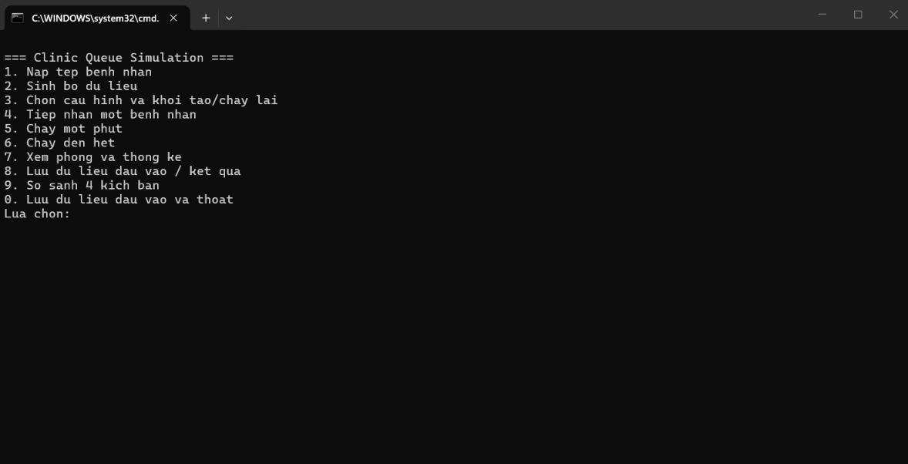
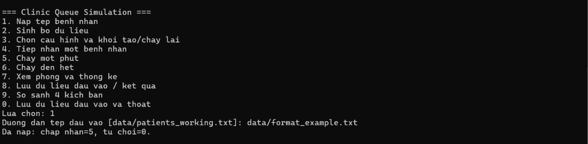
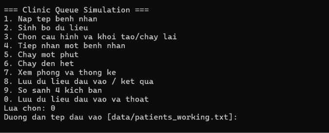

# Bàn giao Giai đoạn 3 — Thành viên A

**Phụ trách:** `src/LinkedQueue.cpp`, `src/ClinicRoom.cpp` (chỉ sửa khi phát hiện lỗi), `tests/test_a.cpp`, kịch bản `tests/console/a_*.in` kèm `.expected`, ảnh console trong `docs/Giai Doan 3/img/`.

> Leader đã rà soát và viết lại bàn giao này ngày 23/11/2026.
> - Kịch bản cũ `a_empty.in` bị lệch một dòng ở bước cấu hình: câu "Bat uu tien?" nhận nhầm số `7`, nên ca không xem được snapshot và không thoát bình thường. Ca này cũng nạp 5 bệnh nhân chứ không phải phòng trống.
> - `a_20min.in` cũ chạy `format_example.txt` với giờ đóng nhận 120, không theo dõi 20 phút đầu của bộ mẫu như phân công yêu cầu.
> - Leader đã viết lại 4 kịch bản (bỏ CRLF, lưu tệp thoát vào `build/console/`), tính tay mong đợi và thêm tệp `.expected`.
> - Ảnh console của A được giữ nguyên.

## 1. Đã làm gì

- **Snapshot (menu 5 và 7):** mỗi phòng hiện số chờ FIFO, số chờ heap, người đang khám và giờ xong; phòng trống hiện `dang kham=khong`. Kiểm bằng `a_empty` (phòng trống) và `a_busy` (phòng bận, có cả heap và FIFO).
- **Theo dõi 20 phút đầu bộ mẫu:** phòng 1 (Nội), cấu hình 1 phòng/khoa, bật ưu tiên, dữ liệu `data/patients_sample.txt`. Có bảng tính tay ở mục 3.2.
- **Tắt ưu tiên:** heap luôn rỗng, mọi người qua FIFO đúng thứ tự đến (`a_no_priority`).
- **Ảnh console** các luồng chính, xem mục 4.
- Không phát hiện lỗi trong `LinkedQueue`/`ClinicRoom`, nên không sửa mã nguồn.

## 2. Cách chạy

macOS 26.5 arm64, Apple clang 16.0.0, GNU Make 3.81. Chạy sau khi đã merge PR của C (#17) và Leader (#20), vì cần `data/patients_sample.txt` và `tests/console/run_console_tests.sh`.

```bash
make
make test-a                  # 9 nhóm PASS
make test-console            # hoặc: sh tests/console/run_console_tests.sh a_
```

## 3. Kết quả

### 3.1. Các ca bắt buộc

| Ca | Thao tác | Mong đợi | Thực tế | Đạt |
|---|---|---|---|---|
| `a_empty` | Không nạp dữ liệu → khởi tạo 1 phòng/khoa → xem (7) → thoát | 3 phòng `dang kham=khong`, hàng 0/0; mọi mức "Chua co du lieu"; `Da hoan tat=0` | Đúng như mong đợi; lưu 0 bệnh nhân rồi thoát | Đạt |
| `a_busy` | `format_example.txt` (5 người Nội), bật ưu tiên, chạy 6 phút | Phút 3: `cho thuong=1, cho uu tien=3, dang kham=BN01`. Phút 5: BN04 (cấp cứu) được gọi, `cho thuong=1, cho uu tien=2, ket thuc=10` | Khớp | Đạt |
| `a_no_priority` | Như trên, tắt ưu tiên, chạy 10 phút rồi chạy hết | Mọi snapshot `cho uu tien=0`; thứ tự bắt đầu theo thứ tự đến: BN01 0, BN02 5, BN03 10, BN05 15, BN04 20 | 0 dòng có `cho uu tien` khác 0; `BN04\|5\|3\|20\|17` … `BN01\|1\|0\|0\|0` | Đạt |
| `a_20min` | Bộ mẫu 30 người, 1 phòng/khoa, bật ưu tiên, chạy phút 0–20 | Bảng 3.2 | Khớp | Đạt |

### 3.2. Phòng 1 (Nội), 20 phút đầu bộ mẫu

Bệnh nhân Nội đến trước phút 20 (ticket, mức, phút đến, thời lượng):

- BN01 (1, 2, 0, 5), BN04 (4, 2, 0, 8), BN07 (7, 1, 2, 11), BN10 (10, 2, 3, 14), BN13 (13, 0, 4, 6)
- BN16 (16, 0, 5, 9), BN19 (19, 2, 6, 12), BN22 (22, 2, 7, 15), BN25 (25, 1, 9, 7), BN28 (28, 2, 12, 10)

Mức 0/1 vào heap, xếp theo mức → phút đến → ticket. Mức 2 vào FIFO.

| Phút | Hoàn tất | Được gọi | Heap sau khi gọi | FIFO sau khi gọi |
|---|---|---|---|---|
| 0 | — | BN01 (xong lúc 5) | — | BN04 |
| 5 | BN01 | BN13 (mức 0, đến 4, xong lúc 11) | BN16, BN07 | BN04, BN10 |
| 11 | BN13 | BN16 (mức 0, đến 5, xong lúc 20) | BN07, BN25 | BN04, BN10, BN19, BN22 |
| 20 | BN16 | BN07 (mức 1, đến 2, xong lúc 31) | BN25 | BN04, BN10, BN19, BN22, BN28 |

Đầu ra thật (`build/console/a_20min.out`, chỉ dòng phòng 1 ở các phút có thay đổi):

```text
Phut 0:  cho thuong=1, cho uu tien=0, dang kham=BN01, ket thuc=5
Phut 4:  cho thuong=2, cho uu tien=2, dang kham=BN01, ket thuc=5
Phut 5:  cho thuong=2, cho uu tien=2, dang kham=BN13, ket thuc=11
Phut 9:  cho thuong=4, cho uu tien=3, dang kham=BN13, ket thuc=11
Phut 11: cho thuong=4, cho uu tien=2, dang kham=BN16, ket thuc=20
Phut 12: cho thuong=5, cho uu tien=2, dang kham=BN16, ket thuc=20
Phut 20: cho thuong=5, cho uu tien=1, dang kham=BN07, ket thuc=31
```

Nhận xét: người thường BN04 đến từ phút 0 nhưng tới phút 20 vẫn chờ, vì liên tục có người cấp cứu hoặc ưu tiên đến. Đây là hành vi đúng theo quy tắc "heap trước FIFO", và là dữ liệu dùng được cho phần so sánh ở giai đoạn 4.

## 4. Ảnh console


**Hình 1: Giao diện Menu chính của chương trình**


**Hình 2: Tiếp nhận bệnh nhân**


**Hình 3: Nạp dữ liệu đầu vào bệnh nhân**


**Hình 4: Trạng thái mô phỏng theo từng phút (phòng khám & hàng đợi ưu tiên)**


**Hình 5: Bảng thống kê tổng hợp cuối ca khám**


**Hình 6: Lưu dữ liệu kết quả và thoát chương trình**


## 5. Còn lại / chờ người khác

- **Windows:** chưa chạy `mingw32-make test-a` (việc tồn từ mốc 0). A cần chạy trên máy Windows và ghi kết quả vào đây.
- **Kiểm tra chéo:** A chạy kịch bản `c_*` của C, B chạy `a_*` của A, và ghi kết quả vào mục kiểm tra chéo của bàn giao người kia.
- Ảnh console được chụp trước khi Leader sửa luồng tiếp nhận (menu 4 giờ in thêm `phong=<mã>`). Nên chụp lại `a_tiep_nhan.png` trước khi đưa vào slide.
