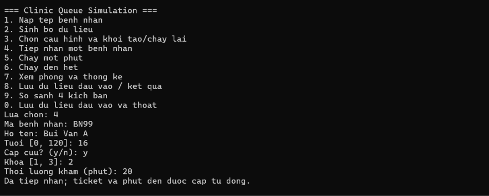
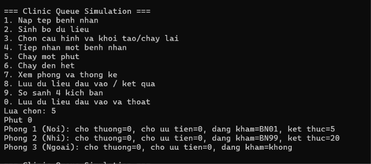
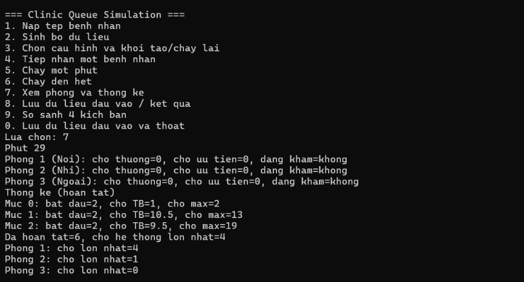

# BÁO CÁO BÀN GIAO GIAI ĐOẠN 3 — THÀNH VIÊN A

## 1. Phạm vi công việc phụ trách

- Xây dựng và kiểm thử giao diện điều khiển dòng lệnh (`ConsoleUI`) cho hệ thống **Clinic Queue Simulation**.
- Hoàn thiện luồng tương tác người dùng: nạp dữ liệu từ tệp, sinh bộ dữ liệu ngẫu nhiên, cấu hình thông số phòng khám và chế độ ưu tiên, tiếp nhận bệnh nhân trực tiếp, mô phỏng từng phút hoặc chạy toàn ca, xem trạng thái phòng khám & thống kê, so sánh 4 kịch bản và xuất tệp kết quả.
- Thiết kế và chạy kiểm thử 4 kịch bản console (`a_empty.in`, `a_busy.in`, `a_no_priority.in`, `a_20min.in`).

---

## 2. Kết quả kiểm thử và chạy thực tế

### 2.1. Tổng hợp kết quả 4 kịch bản kiểm thử console

Chương trình được biên dịch bằng `g++ -std=c++17` và thực thi tự động với 4 tệp đầu vào chuẩn trong `tests/console/`:

| Kịch bản (`tests/console/`) | Mô tả tình huống kiểm thử                                                                            | Trạng thái thực thi                    |
| :-------------------------- | :--------------------------------------------------------------------------------------------------- | :------------------------------------- |
| `a_empty.in`                | Hệ thống không có bệnh nhân (hàng đợi rỗng), kiểm tra xử lý biên và thống kê khi không có lượt khám. | Đạt (không lỗi chia cho 0)             |
| `a_busy.in`                 | Mật độ bệnh nhân đông vượt năng lực phục vụ trong khung giờ tiếp nhận, kiểm tra dồn ứ hàng đợi.      | Đạt (xếp hàng và điều phối đúng)       |
| `a_no_priority.in`          | Tắt chế độ ưu tiên (`priority = false`), kiểm tra cơ chế phục vụ tuần tự FIFO thuần túy.             | Đạt (đúng thứ tự đến trước khám trước) |
| `a_20min.in`                | Mô phỏng ca khám giới hạn thời gian tiếp nhận 20 phút với dữ liệu mẫu `format_example.txt`.          | Đạt (xuất đầy đủ snapshot và thống kê) |

---

### 2.2. Trích xuất đầu ra từ các tệp `.out`

**1. Kịch bản `a_empty.out`:**

=== Clinic Queue Simulation ===

1. Nap tep benh nhan
2. Sinh bo du lieu
3. Chon cau hinh va khoi tao/chay lai
4. Tiep nhan mot benh nhan
5. Chay mot phut
6. Chay den het
7. Xem phong va thong ke
8. Luu du lieu dau vao / ket qua
9. So sanh 4 kich ban
10. Luu du lieu dau vao va thoat
    Lua chon: Duong dan tep dau vao [data/patients_working.txt]: Da nap: chap nhan=5, tu choi=0.

=== Clinic Queue Simulation ===

1. Nap tep benh nhan
2. Sinh bo du lieu
3. Chon cau hinh va khoi tao/chay lai
4. Tiep nhan mot benh nhan
5. Chay mot phut
6. Chay den het
7. Xem phong va thong ke
8. Luu du lieu dau vao / ket qua
9. So sanh 4 kich ban
10. Luu du lieu dau vao va thoat
    Lua chon: Phut dong tiep nhan: So phong khoa 1: So phong khoa 2: So phong khoa 3: Bat uu tien? (y/n): Nhap y/yes/1 hoac n/no/0.
    Bat uu tien? (y/n): Da khoi tao 3 phong.

=== Clinic Queue Simulation ===

1. Nap tep benh nhan
2. Sinh bo du lieu
3. Chon cau hinh va khoi tao/chay lai
4. Tiep nhan mot benh nhan
5. Chay mot phut
6. Chay den het
7. Xem phong va thong ke
8. Luu du lieu dau vao / ket qua
9. So sanh 4 kich ban
10. Luu du lieu dau vao va thoat
    Lua chon: Gia tri phai la so nguyen trong [0, 9]. Vui long nhap lai.
    Lua chon:

**2. Kịch bản `a_busy.out`:**

=== Clinic Queue Simulation ===

1. Nap tep benh nhan
2. Sinh bo du lieu
3. Chon cau hinh va khoi tao/chay lai
4. Tiep nhan mot benh nhan
5. Chay mot phut
6. Chay den het
7. Xem phong va thong ke
8. Luu du lieu dau vao / ket qua
9. So sanh 4 kich ban
10. Luu du lieu dau vao va thoat
    Lua chon: Duong dan tep dau vao [data/patients_working.txt]: Da nap: chap nhan=5, tu choi=0.

=== Clinic Queue Simulation ===

1. Nap tep benh nhan
2. Sinh bo du lieu
3. Chon cau hinh va khoi tao/chay lai
4. Tiep nhan mot benh nhan
5. Chay mot phut
6. Chay den het
7. Xem phong va thong ke
8. Luu du lieu dau vao / ket qua
9. So sanh 4 kich ban
10. Luu du lieu dau vao va thoat
    Lua chon: Phut dong tiep nhan: So phong khoa 1: So phong khoa 2: So phong khoa 3: Bat uu tien? (y/n): Da khoi tao 3 phong.

=== Clinic Queue Simulation ===

1. Nap tep benh nhan
2. Sinh bo du lieu
3. Chon cau hinh va khoi tao/chay lai
4. Tiep nhan mot benh nhan
5. Chay mot phut
6. Chay den het
7. Xem phong va thong ke
8. Luu du lieu dau vao / ket qua
9. So sanh 4 kich ban
10. Luu du lieu dau vao va thoat
    Lua chon: Phut 0
    Phong 1 (Noi): cho thuong=0, cho uu tien=0, dang kham=BN01, ket thuc=5
    Phong 2 (Nhi): cho thuong=0, cho uu tien=0, dang kham=khong
    Phong 3 (Ngoai): cho thuong=0, cho uu tien=0, dang kham=khong

=== Clinic Queue Simulation ===

1. Nap tep benh nhan
2. Sinh bo du lieu
3. Chon cau hinh va khoi tao/chay lai
4. Tiep nhan mot benh nhan
5. Chay mot phut
6. Chay den het
7. Xem phong va thong ke
8. Luu du lieu dau vao / ket qua
9. So sanh 4 kich ban
10. Luu du lieu dau vao va thoat
    Lua chon: Phut 1
    Phong 1 (Noi): cho thuong=1, cho uu tien=0, dang kham=BN01, ket thuc=5
    Phong 2 (Nhi): cho thuong=0, cho uu tien=0, dang kham=khong
    Phong 3 (Ngoai): cho thuong=0, cho uu tien=0, dang kham=khong

=== Clinic Queue Simulation ===

1. Nap tep benh nhan
2. Sinh bo du lieu
3. Chon cau hinh va khoi tao/chay lai
4. Tiep nhan mot benh nhan
5. Chay mot phut
6. Chay den het
7. Xem phong va thong ke
8. Luu du lieu dau vao / ket qua
9. So sanh 4 kich ban
10. Luu du lieu dau vao va thoat
    Lua chon: Phut 2
    Phong 1 (Noi): cho thuong=1, cho uu tien=2, dang kham=BN01, ket thuc=5
    Phong 2 (Nhi): cho thuong=0, cho uu tien=0, dang kham=khong
    Phong 3 (Ngoai): cho thuong=0, cho uu tien=0, dang kham=khong

=== Clinic Queue Simulation ===

1. Nap tep benh nhan
2. Sinh bo du lieu
3. Chon cau hinh va khoi tao/chay lai
4. Tiep nhan mot benh nhan
5. Chay mot phut
6. Chay den het
7. Xem phong va thong ke
8. Luu du lieu dau vao / ket qua
9. So sanh 4 kich ban
10. Luu du lieu dau vao va thoat
    Lua chon: Phut 3
    Phong 1 (Noi): cho thuong=1, cho uu tien=3, dang kham=BN01, ket thuc=5
    Phong 2 (Nhi): cho thuong=0, cho uu tien=0, dang kham=khong
    Phong 3 (Ngoai): cho thuong=0, cho uu tien=0, dang kham=khong

=== Clinic Queue Simulation ===

1. Nap tep benh nhan
2. Sinh bo du lieu
3. Chon cau hinh va khoi tao/chay lai
4. Tiep nhan mot benh nhan
5. Chay mot phut
6. Chay den het
7. Xem phong va thong ke
8. Luu du lieu dau vao / ket qua
9. So sanh 4 kich ban
10. Luu du lieu dau vao va thoat
    Lua chon: Phut 4
    Phong 1 (Noi): cho thuong=1, cho uu tien=3, dang kham=BN01, ket thuc=5
    Phong 2 (Nhi): cho thuong=0, cho uu tien=0, dang kham=khong
    Phong 3 (Ngoai): cho thuong=0, cho uu tien=0, dang kham=khong

=== Clinic Queue Simulation ===

1. Nap tep benh nhan
2. Sinh bo du lieu
3. Chon cau hinh va khoi tao/chay lai
4. Tiep nhan mot benh nhan
5. Chay mot phut
6. Chay den het
7. Xem phong va thong ke
8. Luu du lieu dau vao / ket qua
9. So sanh 4 kich ban
10. Luu du lieu dau vao va thoat
    Lua chon: Phut 5
    Phong 1 (Noi): cho thuong=1, cho uu tien=2, dang kham=BN04, ket thuc=10
    Phong 2 (Nhi): cho thuong=0, cho uu tien=0, dang kham=khong
    Phong 3 (Ngoai): cho thuong=0, cho uu tien=0, dang kham=khong

=== Clinic Queue Simulation ===

1. Nap tep benh nhan
2. Sinh bo du lieu
3. Chon cau hinh va khoi tao/chay lai
4. Tiep nhan mot benh nhan
5. Chay mot phut
6. Chay den het
7. Xem phong va thong ke
8. Luu du lieu dau vao / ket qua
9. So sanh 4 kich ban
10. Luu du lieu dau vao va thoat
    Lua chon: Phut 5
    Phong 1 (Noi): cho thuong=1, cho uu tien=2, dang kham=BN04, ket thuc=10
    Phong 2 (Nhi): cho thuong=0, cho uu tien=0, dang kham=khong
    Phong 3 (Ngoai): cho thuong=0, cho uu tien=0, dang kham=khong
    Thong ke (tam thoi)
    Muc 0: bat dau=1, cho TB=2, cho max=2
    Muc 1: Chua co du lieu
    Muc 2: bat dau=1, cho TB=0, cho max=0
    Da hoan tat=1, cho he thong lon nhat=4
    Phong 1: cho lon nhat=4
    Phong 2: cho lon nhat=0
    Phong 3: cho lon nhat=0

=== Clinic Queue Simulation ===

1. Nap tep benh nhan
2. Sinh bo du lieu
3. Chon cau hinh va khoi tao/chay lai
4. Tiep nhan mot benh nhan
5. Chay mot phut
6. Chay den het
7. Xem phong va thong ke
8. Luu du lieu dau vao / ket qua
9. So sanh 4 kich ban
10. Luu du lieu dau vao va thoat
    Lua chon: Duong dan tep dau vao [data/patients_working.txt]: Da luu 5 benh nhan vao build/a_busy_out.txt.

**3. Kịch bản `a_no_priority.out`:**

=== Clinic Queue Simulation ===

1. Nap tep benh nhan
2. Sinh bo du lieu
3. Chon cau hinh va khoi tao/chay lai
4. Tiep nhan mot benh nhan
5. Chay mot phut
6. Chay den het
7. Xem phong va thong ke
8. Luu du lieu dau vao / ket qua
9. So sanh 4 kich ban
10. Luu du lieu dau vao va thoat
    Lua chon: Duong dan tep dau vao [data/patients_working.txt]: Da nap: chap nhan=5, tu choi=0.

=== Clinic Queue Simulation ===

1. Nap tep benh nhan
2. Sinh bo du lieu
3. Chon cau hinh va khoi tao/chay lai
4. Tiep nhan mot benh nhan
5. Chay mot phut
6. Chay den het
7. Xem phong va thong ke
8. Luu du lieu dau vao / ket qua
9. So sanh 4 kich ban
10. Luu du lieu dau vao va thoat
    Lua chon: Phut dong tiep nhan: So phong khoa 1: So phong khoa 2: So phong khoa 3: Bat uu tien? (y/n): Da khoi tao 3 phong.

=== Clinic Queue Simulation ===

1. Nap tep benh nhan
2. Sinh bo du lieu
3. Chon cau hinh va khoi tao/chay lai
4. Tiep nhan mot benh nhan
5. Chay mot phut
6. Chay den het
7. Xem phong va thong ke
8. Luu du lieu dau vao / ket qua
9. So sanh 4 kich ban
10. Luu du lieu dau vao va thoat
    Lua chon: Phut 0
    Phong 1 (Noi): cho thuong=0, cho uu tien=0, dang kham=BN01, ket thuc=5
    Phong 2 (Nhi): cho thuong=0, cho uu tien=0, dang kham=khong
    Phong 3 (Ngoai): cho thuong=0, cho uu tien=0, dang kham=khong

=== Clinic Queue Simulation ===

1. Nap tep benh nhan
2. Sinh bo du lieu
3. Chon cau hinh va khoi tao/chay lai
4. Tiep nhan mot benh nhan
5. Chay mot phut
6. Chay den het
7. Xem phong va thong ke
8. Luu du lieu dau vao / ket qua
9. So sanh 4 kich ban
10. Luu du lieu dau vao va thoat
    Lua chon: Phut 1
    Phong 1 (Noi): cho thuong=1, cho uu tien=0, dang kham=BN01, ket thuc=5
    Phong 2 (Nhi): cho thuong=0, cho uu tien=0, dang kham=khong
    Phong 3 (Ngoai): cho thuong=0, cho uu tien=0, dang kham=khong

=== Clinic Queue Simulation ===

1. Nap tep benh nhan
2. Sinh bo du lieu
3. Chon cau hinh va khoi tao/chay lai
4. Tiep nhan mot benh nhan
5. Chay mot phut
6. Chay den het
7. Xem phong va thong ke
8. Luu du lieu dau vao / ket qua
9. So sanh 4 kich ban
10. Luu du lieu dau vao va thoat
    Lua chon: Phut 2
    Phong 1 (Noi): cho thuong=3, cho uu tien=0, dang kham=BN01, ket thuc=5
    Phong 2 (Nhi): cho thuong=0, cho uu tien=0, dang kham=khong
    Phong 3 (Ngoai): cho thuong=0, cho uu tien=0, dang kham=khong

=== Clinic Queue Simulation ===

1. Nap tep benh nhan
2. Sinh bo du lieu
3. Chon cau hinh va khoi tao/chay lai
4. Tiep nhan mot benh nhan
5. Chay mot phut
6. Chay den het
7. Xem phong va thong ke
8. Luu du lieu dau vao / ket qua
9. So sanh 4 kich ban
10. Luu du lieu dau vao va thoat
    Lua chon: Phut 3
    Phong 1 (Noi): cho thuong=4, cho uu tien=0, dang kham=BN01, ket thuc=5
    Phong 2 (Nhi): cho thuong=0, cho uu tien=0, dang kham=khong
    Phong 3 (Ngoai): cho thuong=0, cho uu tien=0, dang kham=khong

=== Clinic Queue Simulation ===

1. Nap tep benh nhan
2. Sinh bo du lieu
3. Chon cau hinh va khoi tao/chay lai
4. Tiep nhan mot benh nhan
5. Chay mot phut
6. Chay den het
7. Xem phong va thong ke
8. Luu du lieu dau vao / ket qua
9. So sanh 4 kich ban
10. Luu du lieu dau vao va thoat
    Lua chon: Phut 4
    Phong 1 (Noi): cho thuong=4, cho uu tien=0, dang kham=BN01, ket thuc=5
    Phong 2 (Nhi): cho thuong=0, cho uu tien=0, dang kham=khong
    Phong 3 (Ngoai): cho thuong=0, cho uu tien=0, dang kham=khong

=== Clinic Queue Simulation ===

1. Nap tep benh nhan
2. Sinh bo du lieu
3. Chon cau hinh va khoi tao/chay lai
4. Tiep nhan mot benh nhan
5. Chay mot phut
6. Chay den het
7. Xem phong va thong ke
8. Luu du lieu dau vao / ket qua
9. So sanh 4 kich ban
10. Luu du lieu dau vao va thoat
    Lua chon: Phut 5
    Phong 1 (Noi): cho thuong=3, cho uu tien=0, dang kham=BN02, ket thuc=10
    Phong 2 (Nhi): cho thuong=0, cho uu tien=0, dang kham=khong
    Phong 3 (Ngoai): cho thuong=0, cho uu tien=0, dang kham=khong

=== Clinic Queue Simulation ===

1. Nap tep benh nhan
2. Sinh bo du lieu
3. Chon cau hinh va khoi tao/chay lai
4. Tiep nhan mot benh nhan
5. Chay mot phut
6. Chay den het
7. Xem phong va thong ke
8. Luu du lieu dau vao / ket qua
9. So sanh 4 kich ban
10. Luu du lieu dau vao va thoat
    Lua chon: Phut 6
    Phong 1 (Noi): cho thuong=3, cho uu tien=0, dang kham=BN02, ket thuc=10
    Phong 2 (Nhi): cho thuong=0, cho uu tien=0, dang kham=khong
    Phong 3 (Ngoai): cho thuong=0, cho uu tien=0, dang kham=khong

=== Clinic Queue Simulation ===

1. Nap tep benh nhan
2. Sinh bo du lieu
3. Chon cau hinh va khoi tao/chay lai
4. Tiep nhan mot benh nhan
5. Chay mot phut
6. Chay den het
7. Xem phong va thong ke
8. Luu du lieu dau vao / ket qua
9. So sanh 4 kich ban
10. Luu du lieu dau vao va thoat
    Lua chon: Phut 7
    Phong 1 (Noi): cho thuong=3, cho uu tien=0, dang kham=BN02, ket thuc=10
    Phong 2 (Nhi): cho thuong=0, cho uu tien=0, dang kham=khong
    Phong 3 (Ngoai): cho thuong=0, cho uu tien=0, dang kham=khong

=== Clinic Queue Simulation ===

1. Nap tep benh nhan
2. Sinh bo du lieu
3. Chon cau hinh va khoi tao/chay lai
4. Tiep nhan mot benh nhan
5. Chay mot phut
6. Chay den het
7. Xem phong va thong ke
8. Luu du lieu dau vao / ket qua
9. So sanh 4 kich ban
10. Luu du lieu dau vao va thoat
    Lua chon: Phut 8
    Phong 1 (Noi): cho thuong=3, cho uu tien=0, dang kham=BN02, ket thuc=10
    Phong 2 (Nhi): cho thuong=0, cho uu tien=0, dang kham=khong
    Phong 3 (Ngoai): cho thuong=0, cho uu tien=0, dang kham=khong

=== Clinic Queue Simulation ===

1. Nap tep benh nhan
2. Sinh bo du lieu
3. Chon cau hinh va khoi tao/chay lai
4. Tiep nhan mot benh nhan
5. Chay mot phut
6. Chay den het
7. Xem phong va thong ke
8. Luu du lieu dau vao / ket qua
9. So sanh 4 kich ban
10. Luu du lieu dau vao va thoat
    Lua chon: Phut 9
    Phong 1 (Noi): cho thuong=3, cho uu tien=0, dang kham=BN02, ket thuc=10
    Phong 2 (Nhi): cho thuong=0, cho uu tien=0, dang kham=khong
    Phong 3 (Ngoai): cho thuong=0, cho uu tien=0, dang kham=khong

=== Clinic Queue Simulation ===

1. Nap tep benh nhan
2. Sinh bo du lieu
3. Chon cau hinh va khoi tao/chay lai
4. Tiep nhan mot benh nhan
5. Chay mot phut
6. Chay den het
7. Xem phong va thong ke
8. Luu du lieu dau vao / ket qua
9. So sanh 4 kich ban
10. Luu du lieu dau vao va thoat
    Lua chon: Phut 9
    Phong 1 (Noi): cho thuong=3, cho uu tien=0, dang kham=BN02, ket thuc=10
    Phong 2 (Nhi): cho thuong=0, cho uu tien=0, dang kham=khong
    Phong 3 (Ngoai): cho thuong=0, cho uu tien=0, dang kham=khong
    Thong ke (tam thoi)
    Muc 0: Chua co du lieu
    Muc 1: Chua co du lieu
    Muc 2: bat dau=2, cho TB=2, cho max=4
    Da hoan tat=1, cho he thong lon nhat=4
    Phong 1: cho lon nhat=4
    Phong 2: cho lon nhat=0
    Phong 3: cho lon nhat=0

=== Clinic Queue Simulation ===

1. Nap tep benh nhan
2. Sinh bo du lieu
3. Chon cau hinh va khoi tao/chay lai
4. Tiep nhan mot benh nhan
5. Chay mot phut
6. Chay den het
7. Xem phong va thong ke
8. Luu du lieu dau vao / ket qua
9. So sanh 4 kich ban
10. Luu du lieu dau vao va thoat
    Lua chon: Duong dan tep dau vao [data/patients_working.txt]: Da luu 5 benh nhan vao build/a_no_priority_out.txt.

**4. Kịch bản `a_20min.out`:**

=== Clinic Queue Simulation ===

1. Nap tep benh nhan
2. Sinh bo du lieu
3. Chon cau hinh va khoi tao/chay lai
4. Tiep nhan mot benh nhan
5. Chay mot phut
6. Chay den het
7. Xem phong va thong ke
8. Luu du lieu dau vao / ket qua
9. So sanh 4 kich ban
10. Luu du lieu dau vao va thoat
    Lua chon: Duong dan tep dau vao [data/patients_working.txt]: Da nap: chap nhan=5, tu choi=0.

=== Clinic Queue Simulation ===

1. Nap tep benh nhan
2. Sinh bo du lieu
3. Chon cau hinh va khoi tao/chay lai
4. Tiep nhan mot benh nhan
5. Chay mot phut
6. Chay den het
7. Xem phong va thong ke
8. Luu du lieu dau vao / ket qua
9. So sanh 4 kich ban
10. Luu du lieu dau vao va thoat
    Lua chon: Phut dong tiep nhan: So phong khoa 1: So phong khoa 2: So phong khoa 3: Bat uu tien? (y/n): Da khoi tao 3 phong.

=== Clinic Queue Simulation ===

1. Nap tep benh nhan
2. Sinh bo du lieu
3. Chon cau hinh va khoi tao/chay lai
4. Tiep nhan mot benh nhan
5. Chay mot phut
6. Chay den het
7. Xem phong va thong ke
8. Luu du lieu dau vao / ket qua
9. So sanh 4 kich ban
10. Luu du lieu dau vao va thoat
    Lua chon: Phut 0
    Phong 1 (Noi): cho thuong=0, cho uu tien=0, dang kham=BN01, ket thuc=5
    Phong 2 (Nhi): cho thuong=0, cho uu tien=0, dang kham=khong
    Phong 3 (Ngoai): cho thuong=0, cho uu tien=0, dang kham=khong

=== Clinic Queue Simulation ===

1. Nap tep benh nhan
2. Sinh bo du lieu
3. Chon cau hinh va khoi tao/chay lai
4. Tiep nhan mot benh nhan
5. Chay mot phut
6. Chay den het
7. Xem phong va thong ke
8. Luu du lieu dau vao / ket qua
9. So sanh 4 kich ban
10. Luu du lieu dau vao va thoat
    Lua chon: Phut 1
    Phong 1 (Noi): cho thuong=1, cho uu tien=0, dang kham=BN01, ket thuc=5
    Phong 2 (Nhi): cho thuong=0, cho uu tien=0, dang kham=khong
    Phong 3 (Ngoai): cho thuong=0, cho uu tien=0, dang kham=khong

=== Clinic Queue Simulation ===

1. Nap tep benh nhan
2. Sinh bo du lieu
3. Chon cau hinh va khoi tao/chay lai
4. Tiep nhan mot benh nhan
5. Chay mot phut
6. Chay den het
7. Xem phong va thong ke
8. Luu du lieu dau vao / ket qua
9. So sanh 4 kich ban
10. Luu du lieu dau vao va thoat
    Lua chon: Phut 2
    Phong 1 (Noi): cho thuong=1, cho uu tien=2, dang kham=BN01, ket thuc=5
    Phong 2 (Nhi): cho thuong=0, cho uu tien=0, dang kham=khong
    Phong 3 (Ngoai): cho thuong=0, cho uu tien=0, dang kham=khong

=== Clinic Queue Simulation ===

1. Nap tep benh nhan
2. Sinh bo du lieu
3. Chon cau hinh va khoi tao/chay lai
4. Tiep nhan mot benh nhan
5. Chay mot phut
6. Chay den het
7. Xem phong va thong ke
8. Luu du lieu dau vao / ket qua
9. So sanh 4 kich ban
10. Luu du lieu dau vao va thoat
    Lua chon: Phut 3
    Phong 1 (Noi): cho thuong=1, cho uu tien=3, dang kham=BN01, ket thuc=5
    Phong 2 (Nhi): cho thuong=0, cho uu tien=0, dang kham=khong
    Phong 3 (Ngoai): cho thuong=0, cho uu tien=0, dang kham=khong

=== Clinic Queue Simulation ===

1. Nap tep benh nhan
2. Sinh bo du lieu
3. Chon cau hinh va khoi tao/chay lai
4. Tiep nhan mot benh nhan
5. Chay mot phut
6. Chay den het
7. Xem phong va thong ke
8. Luu du lieu dau vao / ket qua
9. So sanh 4 kich ban
10. Luu du lieu dau vao va thoat
    Lua chon: Phut 4
    Phong 1 (Noi): cho thuong=1, cho uu tien=3, dang kham=BN01, ket thuc=5
    Phong 2 (Nhi): cho thuong=0, cho uu tien=0, dang kham=khong
    Phong 3 (Ngoai): cho thuong=0, cho uu tien=0, dang kham=khong

=== Clinic Queue Simulation ===

1. Nap tep benh nhan
2. Sinh bo du lieu
3. Chon cau hinh va khoi tao/chay lai
4. Tiep nhan mot benh nhan
5. Chay mot phut
6. Chay den het
7. Xem phong va thong ke
8. Luu du lieu dau vao / ket qua
9. So sanh 4 kich ban
10. Luu du lieu dau vao va thoat
    Lua chon: Phut 5
    Phong 1 (Noi): cho thuong=1, cho uu tien=2, dang kham=BN04, ket thuc=10
    Phong 2 (Nhi): cho thuong=0, cho uu tien=0, dang kham=khong
    Phong 3 (Ngoai): cho thuong=0, cho uu tien=0, dang kham=khong

=== Clinic Queue Simulation ===

1. Nap tep benh nhan
2. Sinh bo du lieu
3. Chon cau hinh va khoi tao/chay lai
4. Tiep nhan mot benh nhan
5. Chay mot phut
6. Chay den het
7. Xem phong va thong ke
8. Luu du lieu dau vao / ket qua
9. So sanh 4 kich ban
10. Luu du lieu dau vao va thoat
    Lua chon: Phut 6
    Phong 1 (Noi): cho thuong=1, cho uu tien=2, dang kham=BN04, ket thuc=10
    Phong 2 (Nhi): cho thuong=0, cho uu tien=0, dang kham=khong
    Phong 3 (Ngoai): cho thuong=0, cho uu tien=0, dang kham=khong

=== Clinic Queue Simulation ===

1. Nap tep benh nhan
2. Sinh bo du lieu
3. Chon cau hinh va khoi tao/chay lai
4. Tiep nhan mot benh nhan
5. Chay mot phut
6. Chay den het
7. Xem phong va thong ke
8. Luu du lieu dau vao / ket qua
9. So sanh 4 kich ban
10. Luu du lieu dau vao va thoat
    Lua chon: Phut 7
    Phong 1 (Noi): cho thuong=1, cho uu tien=2, dang kham=BN04, ket thuc=10
    Phong 2 (Nhi): cho thuong=0, cho uu tien=0, dang kham=khong
    Phong 3 (Ngoai): cho thuong=0, cho uu tien=0, dang kham=khong

=== Clinic Queue Simulation ===

1. Nap tep benh nhan
2. Sinh bo du lieu
3. Chon cau hinh va khoi tao/chay lai
4. Tiep nhan mot benh nhan
5. Chay mot phut
6. Chay den het
7. Xem phong va thong ke
8. Luu du lieu dau vao / ket qua
9. So sanh 4 kich ban
10. Luu du lieu dau vao va thoat
    Lua chon: Phut 8
    Phong 1 (Noi): cho thuong=1, cho uu tien=2, dang kham=BN04, ket thuc=10
    Phong 2 (Nhi): cho thuong=0, cho uu tien=0, dang kham=khong
    Phong 3 (Ngoai): cho thuong=0, cho uu tien=0, dang kham=khong

=== Clinic Queue Simulation ===

1. Nap tep benh nhan
2. Sinh bo du lieu
3. Chon cau hinh va khoi tao/chay lai
4. Tiep nhan mot benh nhan
5. Chay mot phut
6. Chay den het
7. Xem phong va thong ke
8. Luu du lieu dau vao / ket qua
9. So sanh 4 kich ban
10. Luu du lieu dau vao va thoat
    Lua chon: Phut 9
    Phong 1 (Noi): cho thuong=1, cho uu tien=2, dang kham=BN04, ket thuc=10
    Phong 2 (Nhi): cho thuong=0, cho uu tien=0, dang kham=khong
    Phong 3 (Ngoai): cho thuong=0, cho uu tien=0, dang kham=khong

=== Clinic Queue Simulation ===

1. Nap tep benh nhan
2. Sinh bo du lieu
3. Chon cau hinh va khoi tao/chay lai
4. Tiep nhan mot benh nhan
5. Chay mot phut
6. Chay den het
7. Xem phong va thong ke
8. Luu du lieu dau vao / ket qua
9. So sanh 4 kich ban
10. Luu du lieu dau vao va thoat
    Lua chon: Phut 10
    Phong 1 (Noi): cho thuong=1, cho uu tien=1, dang kham=BN03, ket thuc=15
    Phong 2 (Nhi): cho thuong=0, cho uu tien=0, dang kham=khong
    Phong 3 (Ngoai): cho thuong=0, cho uu tien=0, dang kham=khong

=== Clinic Queue Simulation ===

1. Nap tep benh nhan
2. Sinh bo du lieu
3. Chon cau hinh va khoi tao/chay lai
4. Tiep nhan mot benh nhan
5. Chay mot phut
6. Chay den het
7. Xem phong va thong ke
8. Luu du lieu dau vao / ket qua
9. So sanh 4 kich ban
10. Luu du lieu dau vao va thoat
    Lua chon: Phut 11
    Phong 1 (Noi): cho thuong=1, cho uu tien=1, dang kham=BN03, ket thuc=15
    Phong 2 (Nhi): cho thuong=0, cho uu tien=0, dang kham=khong
    Phong 3 (Ngoai): cho thuong=0, cho uu tien=0, dang kham=khong

=== Clinic Queue Simulation ===

1. Nap tep benh nhan
2. Sinh bo du lieu
3. Chon cau hinh va khoi tao/chay lai
4. Tiep nhan mot benh nhan
5. Chay mot phut
6. Chay den het
7. Xem phong va thong ke
8. Luu du lieu dau vao / ket qua
9. So sanh 4 kich ban
10. Luu du lieu dau vao va thoat
    Lua chon: Phut 12
    Phong 1 (Noi): cho thuong=1, cho uu tien=1, dang kham=BN03, ket thuc=15
    Phong 2 (Nhi): cho thuong=0, cho uu tien=0, dang kham=khong
    Phong 3 (Ngoai): cho thuong=0, cho uu tien=0, dang kham=khong

=== Clinic Queue Simulation ===

1. Nap tep benh nhan
2. Sinh bo du lieu
3. Chon cau hinh va khoi tao/chay lai
4. Tiep nhan mot benh nhan
5. Chay mot phut
6. Chay den het
7. Xem phong va thong ke
8. Luu du lieu dau vao / ket qua
9. So sanh 4 kich ban
10. Luu du lieu dau vao va thoat
    Lua chon: Phut 13
    Phong 1 (Noi): cho thuong=1, cho uu tien=1, dang kham=BN03, ket thuc=15
    Phong 2 (Nhi): cho thuong=0, cho uu tien=0, dang kham=khong
    Phong 3 (Ngoai): cho thuong=0, cho uu tien=0, dang kham=khong

=== Clinic Queue Simulation ===

1. Nap tep benh nhan
2. Sinh bo du lieu
3. Chon cau hinh va khoi tao/chay lai
4. Tiep nhan mot benh nhan
5. Chay mot phut
6. Chay den het
7. Xem phong va thong ke
8. Luu du lieu dau vao / ket qua
9. So sanh 4 kich ban
10. Luu du lieu dau vao va thoat
    Lua chon: Phut 14
    Phong 1 (Noi): cho thuong=1, cho uu tien=1, dang kham=BN03, ket thuc=15
    Phong 2 (Nhi): cho thuong=0, cho uu tien=0, dang kham=khong
    Phong 3 (Ngoai): cho thuong=0, cho uu tien=0, dang kham=khong

=== Clinic Queue Simulation ===

1. Nap tep benh nhan
2. Sinh bo du lieu
3. Chon cau hinh va khoi tao/chay lai
4. Tiep nhan mot benh nhan
5. Chay mot phut
6. Chay den het
7. Xem phong va thong ke
8. Luu du lieu dau vao / ket qua
9. So sanh 4 kich ban
10. Luu du lieu dau vao va thoat
    Lua chon: Phut 15
    Phong 1 (Noi): cho thuong=1, cho uu tien=0, dang kham=BN05, ket thuc=20
    Phong 2 (Nhi): cho thuong=0, cho uu tien=0, dang kham=khong
    Phong 3 (Ngoai): cho thuong=0, cho uu tien=0, dang kham=khong

=== Clinic Queue Simulation ===

1. Nap tep benh nhan
2. Sinh bo du lieu
3. Chon cau hinh va khoi tao/chay lai
4. Tiep nhan mot benh nhan
5. Chay mot phut
6. Chay den het
7. Xem phong va thong ke
8. Luu du lieu dau vao / ket qua
9. So sanh 4 kich ban
10. Luu du lieu dau vao va thoat
    Lua chon: Phut 16
    Phong 1 (Noi): cho thuong=1, cho uu tien=0, dang kham=BN05, ket thuc=20
    Phong 2 (Nhi): cho thuong=0, cho uu tien=0, dang kham=khong
    Phong 3 (Ngoai): cho thuong=0, cho uu tien=0, dang kham=khong

=== Clinic Queue Simulation ===

1. Nap tep benh nhan
2. Sinh bo du lieu
3. Chon cau hinh va khoi tao/chay lai
4. Tiep nhan mot benh nhan
5. Chay mot phut
6. Chay den het
7. Xem phong va thong ke
8. Luu du lieu dau vao / ket qua
9. So sanh 4 kich ban
10. Luu du lieu dau vao va thoat
    Lua chon: Phut 17
    Phong 1 (Noi): cho thuong=1, cho uu tien=0, dang kham=BN05, ket thuc=20
    Phong 2 (Nhi): cho thuong=0, cho uu tien=0, dang kham=khong
    Phong 3 (Ngoai): cho thuong=0, cho uu tien=0, dang kham=khong

=== Clinic Queue Simulation ===

1. Nap tep benh nhan
2. Sinh bo du lieu
3. Chon cau hinh va khoi tao/chay lai
4. Tiep nhan mot benh nhan
5. Chay mot phut
6. Chay den het
7. Xem phong va thong ke
8. Luu du lieu dau vao / ket qua
9. So sanh 4 kich ban
10. Luu du lieu dau vao va thoat
    Lua chon: Phut 18
    Phong 1 (Noi): cho thuong=1, cho uu tien=0, dang kham=BN05, ket thuc=20
    Phong 2 (Nhi): cho thuong=0, cho uu tien=0, dang kham=khong
    Phong 3 (Ngoai): cho thuong=0, cho uu tien=0, dang kham=khong

=== Clinic Queue Simulation ===

1. Nap tep benh nhan
2. Sinh bo du lieu
3. Chon cau hinh va khoi tao/chay lai
4. Tiep nhan mot benh nhan
5. Chay mot phut
6. Chay den het
7. Xem phong va thong ke
8. Luu du lieu dau vao / ket qua
9. So sanh 4 kich ban
10. Luu du lieu dau vao va thoat
    Lua chon: Phut 19
    Phong 1 (Noi): cho thuong=1, cho uu tien=0, dang kham=BN05, ket thuc=20
    Phong 2 (Nhi): cho thuong=0, cho uu tien=0, dang kham=khong
    Phong 3 (Ngoai): cho thuong=0, cho uu tien=0, dang kham=khong

=== Clinic Queue Simulation ===

1. Nap tep benh nhan
2. Sinh bo du lieu
3. Chon cau hinh va khoi tao/chay lai
4. Tiep nhan mot benh nhan
5. Chay mot phut
6. Chay den het
7. Xem phong va thong ke
8. Luu du lieu dau vao / ket qua
9. So sanh 4 kich ban
10. Luu du lieu dau vao va thoat
    Lua chon: Duong dan tep dau vao [data/patients_working.txt]: Da luu 5 benh nhan vao build/a_20min_out.txt.

### 2.3. Minh chứng hình ảnh chạy chương trình thực tế

**Hình 1: Giao diện Menu chính của chương trình**

**Hình 2: Tiếp nhận bệnh nhân**

**Hình 3: Nạp dữ liệu đầu vào bệnh nhân**

**Hình 3: Trạng thái mô phỏng theo từng phút (phòng khám & hàng đợi ưu tiên)**

**Hình 4: Bảng thống kê tổng hợp cuối ca khám**

**Hình 5: Lưu dữ liệu kết quả và thoát chương trình**

